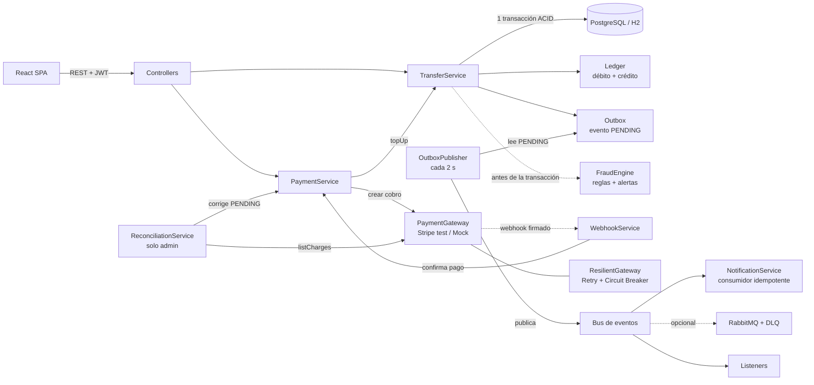
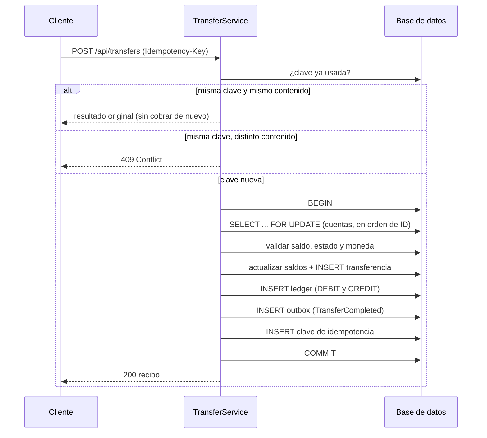
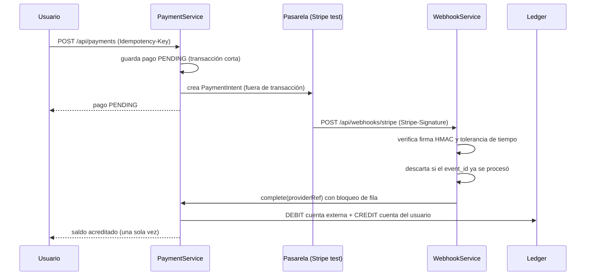

# FinCore — Plataforma de transferencias financieras


Backend de pagos entre cuentas centrado en lo difícil de los sistemas financieros: **transferencias atómicas, concurrencia segura, ledger de doble entrada, reembolsos, reintentos idempotentes, antifraude, pasarela de pagos con webhooks firmados, conciliación, resiliencia (Retry + Circuit Breaker) y eventos con Transactional Outbox**. No maneja dinero real.

> **Estado:** Fases 1, 2 y 3 completas. Redis y RabbitMQ son opcionales y **no se han probado contra servidores reales** (ver [Limitaciones](#estado-y-hoja-de-ruta)). El resto está cubierto por 67 pruebas de backend y 14 de la API simulada del frontend, todas ejecutadas. El frontend se puede desplegar solo en [Demo Mode](#demo-mode-solo-frontend-sin-backend).

## Problema que resuelve

En un sistema de pagos los casos difíciles no son el camino feliz:

| Situación | Cómo lo resuelve FinCore |
|---|---|
| Dos transferencias simultáneas gastan el mismo saldo | Bloqueo pesimista de cuentas + `CHECK (balance >= 0)` en la base |
| El cliente reintenta por un fallo de red y se cobra dos veces | `Idempotency-Key`: mismo resultado, sin segundo cobro |
| A→B y B→A a la vez se bloquean mutuamente (deadlock) | Las cuentas se bloquean siempre en orden de ID |
| Hay que devolver dinero (total o parcial) sin descuadrar la contabilidad | Reembolso = transferencia inversa ligada a la original, con su propio asiento |
| El servicio cae después de guardar y antes de avisar a otros sistemas | Transactional Outbox: el evento se guarda en la misma transacción |
| Una operación sospechosa (monto atípico, ráfaga, vaciado de saldo) | Motor antifraude con reglas configurables: puntúa, clasifica y bloquea |
| El proveedor de pagos reenvía el mismo webhook o alguien lo falsifica | Firma HMAC verificada + `event_id` único: se procesa una sola vez |
| Se pierde un webhook y el cliente pagó pero no se acreditó | Conciliación: compara con el proveedor, detecta la diferencia y la corrige una sola vez |
| El proveedor de pagos se cae o responde lento | Retry con la misma `Idempotency-Key` + Circuit Breaker: falla rápido en vez de colgar el servicio |
| Un consumidor de eventos falla con un mensaje defectuoso | Cada evento en su transacción; tras 5 intentos pasa a la cola de errores y se puede reintentar |

## Arquitectura

Monolito modular con eventos. Cada paquete es un módulo con su responsabilidad.



```
backend/src/main/java/com/chinix/fincore/
├── auth/       registro, login, JWT
├── account/    cuentas
├── transfer/   TransferService (núcleo), ledger, idempotencia, reembolsos
├── fraud/      FraudEngine (reglas), alertas, umbrales configurables
├── payment/    PaymentGateway (interfaz) + Stripe/Mock, PaymentService
├── webhook/    verificación de firma, deduplicación, WebhookService
├── reconciliation/  conciliación con el proveedor (solo admin)
├── notification/    consumidor de eventos: notificaciones idempotentes
├── messaging/  RabbitMQ opcional: exchange, cola, DLQ, publicador y consumidor
├── ratelimit/  límite de peticiones por IP (memoria o Redis)
├── system/     estado operativo y cola de errores (solo admin)
├── outbox/     Outbox + OutboxPublisher
└── config/     seguridad, CORS, datos demo (perfil local)
```

### Flujo de una transferencia



### Flujo de una recarga (pasarela + webhook)



## Características técnicas

- **Transacción ACID única** por operación: saldos, transferencia, ledger, outbox e idempotencia se confirman juntos o no se confirma nada.
- **Bloqueo pesimista ordenado.** Evita saldos negativos, doble gasto y deadlocks.
- **Ledger de doble entrada.** Cada movimiento crea un `DEBIT` y un `CREDIT` por el mismo importe. `GET /api/ledger/verify` comprueba que débitos y créditos suman lo mismo.
- **Reembolsos totales y parciales.** El total reembolsado nunca supera el original; solo quien recibió el dinero puede devolverlo; también son idempotentes.
- **Idempotencia con hash SHA-256** del contenido, para distinguir un reintento legítimo de un abuso de la clave.
- **Transactional Outbox** con reintentos y estado `FAILED` tras 5 intentos (equivalente a una cola de errores).
- **Dinero con `BigDecimal`**, escala fija de 2 decimales; se rechazan importes con más decimales, cero o negativos. El saldo nunca lo decide el cliente.
- **Motor antifraude** con tres reglas y umbrales en `application.yml`: `HIGH_AMOUNT` (+70), `VELOCITY` (+40) y `DRAIN_BALANCE` (+30). El puntaje clasifica el riesgo (LOW / MEDIUM / HIGH) y bloquea desde 70 con un `422`. Las alertas se guardan aunque la operación se rechace. Un reintento idempotente no se reevalúa.
- **Pasarela de pagos abstracta.** `PaymentGateway` es una interfaz con dos implementaciones: Stripe (modo prueba, vía REST) y un proveedor simulado. Se elige según haya o no `STRIPE_SECRET_KEY`. La llamada de red se hace fuera de la transacción de base de datos.
- **Recargas con contrapartida contable.** Un pago confirmado crea un movimiento `TOPUP` desde la cuenta "mundo exterior" (`FCSYSTEMEXTERNAL`); el ledger sigue balanceado.
- **Webhooks seguros.** Firma HMAC-SHA256 comparada en tiempo constante, rechazo de mensajes de más de 5 minutos, deduplicación por `event_id` único y procesamiento + registro en la misma transacción (si falla, el proveedor puede reintentar).
- **Resiliencia de la pasarela (Resilience4j).** `ResilientGateway` envuelve al proveedor con Retry (3 intentos; no reintenta errores 4xx) y Circuit Breaker (se abre si falla la mitad de las últimas 5 llamadas y rechaza al instante durante 30 s). Reintentar es seguro porque el cobro lleva `Idempotency-Key`.
- **Conciliación financiera.** Compara los pagos internos con los del proveedor y detecta cuatro diferencias: `STATUS_MISMATCH`, `MISSING_INTERNALLY`, `MISSING_AT_PROVIDER` y `AMOUNT_MISMATCH`. Solo la primera (cobrado pero aún `PENDING`, es decir, un webhook perdido) se corrige automáticamente y una sola vez; el resto exige revisión manual.
- **Consumidores de eventos idempotentes.** Las notificaciones usan `UNIQUE(event_id, user_id)`: una reentrega no duplica nada. Un evento defectuoso va a la cola de errores (`FAILED`) tras 5 intentos y un administrador puede reintentarlo.
- **Roles (RBAC).** El JWT lleva el rol; conciliación y estado del sistema exigen `ADMIN`. `demo@fincore.dev` es administrador en el perfil local.
- **Rate limiting** por IP: 10 intentos/min en login y registro (fuerza bruta) y 60/min en operaciones de dinero, con `429`. En memoria por defecto; Redis opcional para compartirlo entre instancias.
- **Observabilidad.** Cada petición lleva un `X-Request-Id` que aparece en todos sus logs; en el perfil `prod` los logs salen en JSON (ECS); Actuator expone `health`, `info` y `metrics`; `/api/system/health` resume base de datos, cola de eventos, circuit breaker y balance del ledger.
- **Migraciones versionadas** con Flyway (`V1__init` … `V4__reconciliation_and_notifications`).

### Patrones y por qué

| Patrón | Dónde | Justificación |
|---|---|---|
| Transactional Outbox | `outbox/` | Garantiza que no se pierde un evento ni se publica uno de una operación que hizo rollback |
| Idempotent Receiver | `TransferService.replay` | Los clientes reintentan; el servidor debe tolerarlo |
| Pessimistic Locking | `AccountRepository.lockById` | En dinero es preferible esperar un turno a reintentar por conflictos |
| Double-Entry Bookkeeping | `LedgerEntry` | Todo movimiento queda auditado y verificable |
| Decorator + Circuit Breaker | `ResilientGateway` | Añade Retry y protección al proveedor sin modificarlo |
| Consumidor idempotente | `NotificationService` | Con entrega "al menos una vez" los duplicados son normales; el efecto debe ser el mismo |
| Dead Letter Queue | `FAILED` en el outbox / DLQ de RabbitMQ | Un mensaje defectuoso no bloquea al resto y se puede reintentar |
| Strategy (pasarela) | `PaymentGateway` | Cambiar de proveedor sin tocar el negocio; el mock permite probar sin red |
| Rules engine simple | `FraudEngine.evaluate` | Reglas puras y sin base de datos: fáciles de probar y de explicar |
| Webhook idempotente | `WebhookService` | Los proveedores reenvían eventos; procesarlos dos veces duplicaría dinero |
| Monolito modular | paquetes por dominio | Simplicidad operativa; se puede separar en servicios más adelante |

## Pruebas

67 pruebas de backend, **todas ejecutadas y en verde** con `mvn clean test` (y 14 del frontend con `npm test`, ver Demo Mode):

| Archivo | Qué cubre |
|---|---|
| `TransferServiceTest` (integración, H2) | Transferencia y ledger balanceado · saldo insuficiente · cuenta ajena · importes inválidos · **misma clave = un solo cobro** · clave con otro contenido = 409 · **10 peticiones simultáneas con la misma clave** · **20 transferencias simultáneas sin sobregiro** · **transferencias cruzadas sin deadlock** · reembolsos parciales y total · reembolso mayor al original · reembolso por quien no recibió · reembolso duplicado · **reembolsos simultáneos** · evento en outbox |
| `FraudTest` (unitarias + integración) | Reglas HIGH_AMOUNT, VELOCITY y DRAIN_BALANCE · operación normal permitida · **bloqueo real sin mover dinero y con alerta guardada** · ráfaga + vaciado = bloqueo · un reintento idempotente no es bloqueado |
| `WebhookTest` (integración, proveedor simulado con Mockito) | Firma inválida, ausente, vieja o con cuerpo alterado · pago PENDING hasta el webhook · **webhook duplicado acredita una vez** · **10 entregas simultáneas del mismo evento** · eventos distintos del mismo pago · pago fallido · tipo desconocido · misma clave de pago = una llamada al proveedor · **fallo del proveedor (502)** · recarga de cuenta ajena · confirmación síncrona |
| `ResilienceTest` (unitaria, Mockito) | Reintento hasta que el proveedor se recupera · límite de reintentos · los errores 4xx no se reintentan · **el circuito se abre y deja de llamar al proveedor** |
| `ReconciliationTest` (integración) | Registros que coinciden · **webhook perdido detectado y recuperado una sola vez** · ejecutar dos veces no duplica diferencias · cobro sin pago interno · pago acreditado inexistente en el proveedor · diferencia de importe (nunca se autocorrige) |
| `NotificationTest` (integración) | Notifica a ambas partes · **reentrega del mismo evento no duplica** · **un evento venenoso no bloquea a los demás y termina en FAILED** · reintento desde la cola de errores |
| `ApiSecurityTest` (HTTP con MockMvc) | Sin token = 401 · usuario normal = 403 en endpoints de admin · admin accede · cada respuesta trae `X-Request-Id` · el webhook público rechaza mensajes sin firma · **CORS permite solo el origen del frontend** |
| `RateLimitTest` | Login bloqueado con `429` tras exceder el límite · el limitador recupera tras la ventana |
| `RabbitMessagingTest` (Mockito) | El publicador envía con id y routing key correctos · broker caído hace fallar el publicador (el outbox reintenta) · el consumidor delega y propaga errores para la DLQ |
| `OutboxPublisherTest` (unitaria, Mockito) | Publicación correcta · reintentos y paso a `FAILED` · recuperación tras fallo temporal |

### Bugs reales que encontraron las pruebas

1. **Saldo viejo en la caché de Hibernate** (Fase 1): una lectura sin bloqueo dejaba la cuenta en caché y el bloqueo posterior devolvía un saldo desactualizado; con transferencias simultáneas se perdía dinero. Corregido en [`AccountRepository`](backend/src/main/java/com/chinix/fincore/account/AccountRepository.java).
2. **Un evento defectuoso arrastraba a todo el lote del outbox** (Fase 3): al compartir una transacción, un consumidor que fallaba la marcaba como *rollback-only*: se perdían los demás eventos y los intentos nunca se contaban, así que jamás llegaba a `FAILED`. Corregido: cada evento tiene su propia transacción ([`OutboxPublisher`](backend/src/main/java/com/chinix/fincore/outbox/OutboxPublisher.java)). Un test unitario con Mockito no podía verlo; lo encontró la prueba de integración.
3. **CORS nunca estuvo activo** (detectado al verificar el modo real contra el backend): el bean se llamaba `cors` y Spring Security solo reconoce `corsConfigurationSource`, así que el navegador habría bloqueado todas las llamadas del frontend. Corregido en [`SecurityConfig`](backend/src/main/java/com/chinix/fincore/config/SecurityConfig.java) y cubierto con una prueba.
4. **Importes leídos como `double`** (Fase 3): Jackson interpreta `25.00` como `25.0` si no se le indica lo contrario. Los importes se leen ahora como `BigDecimal` ([`NotificationService`](backend/src/main/java/com/chinix/fincore/notification/NotificationService.java)).

## Instalación y ejecución local (sin Docker)

Requisitos: **Java 17 o superior**, **Maven 3.9+** y **Node.js 20+**. No hace falta instalar ninguna base de datos: en local usa H2 en memoria.

```bash
# 1. Backend (http://localhost:8080)
cd backend
mvn spring-boot:run

# 2. Frontend (http://localhost:5173), en otra terminal
cd frontend
npm install
npm run dev
```

El perfil `local` (por defecto) crea dos usuarios con saldo y un proveedor de pagos simulado. Contraseña de ambos: `DemoFinCore2026`

| Usuario | Saldo inicial |
|---|---|
| `demo@fincore.dev` | S/ 1,000.00 |
| `cliente@fincore.dev` | S/ 250.00 |

Para probar: entra como `demo`, copia el número de cuenta de `cliente` (inicia sesión con él en otra ventana privada) y haz una transferencia; luego, como `cliente`, reembólsala desde *Movimientos*. La vista **Ledger** muestra los asientos y la comprobación de balance.

Flujo de recarga en local: en **Pagos** crea una recarga (queda `PENDING`), pulsa **Simular webhook** (solo perfil local) y el saldo se acredita; vuelve a simularlo y el duplicado se ignora (visible en **Webhooks**). En **Riesgo y fraude** verás las alertas (por ejemplo, al intentar transferir S/ 5,000).

> El pom declara Java 21. Si solo tienes Java 17, usa `mvn -Djava.version=17 ...`.

Ejecutar las pruebas: `cd backend && mvn clean test`

### Con PostgreSQL (opcional)

Define `SPRING_PROFILES_ACTIVE=prod`, `DB_URL`, `DB_USER`, `DB_PASSWORD` y `JWT_SECRET` (ver [`.env.example`](.env.example)). Con Docker, `docker compose up --build -d` levanta PostgreSQL y el backend ya configurados. El perfil `prod` también activa los logs en JSON.

### Redis y RabbitMQ (opcionales)

Ambos están **desactivados por defecto** para que el proyecto corra sin Docker. Si los tienes instalados:

- Redis: `REDIS_ENABLED=true` (y `REDIS_HOST`, `REDIS_PORT`). Solo se usa para el rate limiting compartido; nunca guarda saldos ni datos financieros.
- RabbitMQ: `RABBITMQ_ENABLED=true` (y `RABBITMQ_HOST`, `RABBITMQ_USER`, `RABBITMQ_PASSWORD`). Los eventos del outbox se publican en el exchange `fincore.events`, los consume la cola `fincore.notifications` y, tras 3 reintentos, los mensajes rechazados van a `fincore.notifications.dlq`. Con RabbitMQ activo, el consumidor en proceso se desactiva para no duplicar notificaciones.

> **No probado contra servidores reales.** La lógica (publicador, consumidor, reintentos y límites) está cubierta con pruebas y mocks, pero la integración con un Redis o RabbitMQ en ejecución no se ha validado porque no hay ninguno instalado en el entorno de desarrollo.

### Stripe en modo prueba (opcional)

1. Crea una cuenta gratuita en Stripe y copia tu clave **de prueba** (`sk_test_...`) desde *Developers → API keys*.
2. Instala la [Stripe CLI](https://docs.stripe.com/stripe-cli) y ejecuta `stripe listen --forward-to localhost:8080/api/webhooks/stripe`; te mostrará un secreto `whsec_...`.
3. Arranca el backend con `STRIPE_SECRET_KEY=sk_test_...` y `STRIPE_WEBHOOK_SECRET=whsec_...` (ver [`.env.example`](.env.example)).

El cobro usa la tarjeta de prueba `pm_card_visa` de Stripe y la moneda `app.stripe.currency` (por defecto `usd`, sin conversión de divisas). Nunca uses claves `sk_live_`. **Esta integración no se ha ejecutado contra Stripe real**: está probada con el proveedor simulado y con la verificación de firma; falta validarla con tu clave de prueba.

## Demo Mode (solo frontend, sin backend)

El frontend puede funcionar **sin backend ni base de datos**, con datos ficticios guardados en el `LocalStorage` del navegador. Está pensado para desplegar solo el frontend (por ejemplo en Vercel) y que cualquiera pueda probar la aplicación sin instalar nada. El backend, la arquitectura y las conexiones reales no se modifican: es un interruptor.

| | **Modo real** (por defecto) | **Demo Mode** (`VITE_DEMO_MODE=true`) |
|---|---|---|
| Datos | Base de datos (H2 o PostgreSQL) | Ficticios, en `LocalStorage` del navegador |
| Backend | Necesario (`http://localhost:8080`) | No se usa |
| Acceso | Usuarios del backend | Botón **Entrar como usuario demo** (rol administrador) |
| Reglas de negocio | Backend (autoridad real) | Réplica en el navegador: antifraude, idempotencia, reembolsos, webhooks, conciliación |
| Persistencia | Permanente | Solo en tu navegador; botón **Restablecer datos** |
| Identificación | Etiqueta `API LOCAL` | Barra fija **MODO DEMO** en todas las pantallas |
| Uso previsto | Desarrollo y evaluación técnica | Portfolio y pruebas rápidas |

En el Demo Mode puedes transferir, reembolsar (total o parcial), recargar saldo y confirmarlo con **Simular webhook** (pulsarlo dos veces demuestra la deduplicación), ver el ledger, provocar un bloqueo antifraude (transfiere S/ 5,000), ejecutar la conciliación (corrige el pago pendiente) y consultar el estado del sistema. **No es el backend real:** el dinero es ficticio, no hay concurrencia ni base de datos, y los datos son locales a cada navegador.

### Ejecutar en local

```bash
cd frontend
npm install

# Demo Mode (sin backend)
VITE_DEMO_MODE=true npm run dev          # macOS / Linux
$env:VITE_DEMO_MODE="true"; npm run dev  # Windows PowerShell

# Modo real (con el backend en marcha)
npm run dev
```

También puedes crear `frontend/.env` a partir de [`frontend/.env.example`](frontend/.env.example). Ese archivo está en `.gitignore`.

### Desplegar el frontend en Vercel

1. Sube el repositorio a GitHub.
2. En [vercel.com](https://vercel.com) elige **Add New → Project** e importa el repositorio.
3. Configura **Root Directory = `frontend`**. Vercel detecta Vite solo.
4. Pulsa **Deploy**. No necesitas variables de entorno: [`frontend/vercel.json`](frontend/vercel.json) ya compila en Demo Mode (`VITE_DEMO_MODE=true`), redirige todas las rutas a `index.html` y añade cabeceras de seguridad básicas.

Para que un despliegue use un backend real, define en Vercel `VITE_DEMO_MODE=false` y `VITE_API_URL=https://tu-backend/api`, y en el backend `CORS_ORIGIN=https://tu-sitio.vercel.app`. El backend no se despliega con este proyecto: habría que alojarlo aparte.

> **Nota:** este repositorio no incluye ningún despliegue ya publicado. Las instrucciones anteriores son para que lo hagas tú.

## API

| Método | Ruta | Acceso | Descripción |
|---|---|---|---|
| POST | `/api/auth/register` | Pública | Crea usuario y cuenta PEN |
| POST | `/api/auth/login` | Pública | Devuelve un JWT (1 h) |
| GET | `/api/accounts` | JWT | Cuentas del usuario |
| GET | `/api/transfers` | JWT | Últimos 30 movimientos |
| POST | `/api/transfers` | JWT + `Idempotency-Key` | Crea una transferencia |
| POST | `/api/transfers/{id}/refunds` | JWT + `Idempotency-Key` | Reembolso; cuerpo `{"amount": 10.00}` o vacío para el total |
| GET | `/api/ledger` | JWT | Últimos 50 asientos de tus cuentas |
| GET | `/api/ledger/verify` | JWT | Débitos = créditos |
| POST | `/api/payments` | JWT + `Idempotency-Key` | Crea una recarga: `{"accountId": "...", "amount": 100.00}` |
| GET | `/api/payments` | JWT | Tus pagos |
| POST | `/api/webhooks/stripe` | Pública, protegida por firma | Recibe eventos del proveedor (`Stripe-Signature`) |
| GET | `/api/webhooks/events` | JWT | Eventos recibidos de tus pagos |
| GET | `/api/risk/alerts` | JWT | Alertas del antifraude |
| GET | `/api/risk/rules` | JWT | Reglas y umbrales vigentes |
| POST | `/api/dev/payments/{id}/simulate-webhook` | JWT, solo perfil `local` | Simula la confirmación del proveedor |
| GET | `/api/notifications` | JWT | Tus notificaciones |
| POST | `/api/reconciliation/run` | JWT `ADMIN` | Ejecuta la conciliación y devuelve las diferencias abiertas |
| GET | `/api/reconciliation/findings` | JWT `ADMIN` | Diferencias abiertas |
| POST | `/api/reconciliation/findings/{id}/resolve` | JWT `ADMIN` | Corrige un webhook perdido (`STATUS_MISMATCH`) |
| GET | `/api/system/health` | JWT `ADMIN` | Base de datos, cola de eventos, circuit breaker, balance del ledger |
| POST | `/api/system/outbox/requeue` | JWT `ADMIN` | Reintenta los eventos de la cola de errores |
| GET | `/actuator/health` | Pública | Estado del servicio |

```http
POST /api/transfers
Authorization: Bearer <TOKEN>
Idempotency-Key: 9d3d17ac-5d9f-4d58-bb4c-efbb92d8f2ac
Content-Type: application/json

{"sourceAccountId":"UUID","destinationAccountNumber":"FC123...","amount":25.50,"reference":"Prueba"}
```

Códigos: `400` datos o reglas inválidas (saldo insuficiente, importe) · `403` cuenta ajena · `404` transferencia inexistente · `409` clave de idempotencia reutilizada con otro contenido · `422` operación bloqueada por el antifraude · `429` demasiadas peticiones · `502` proveedor de pagos no disponible (incluye circuito abierto).

## Seguridad

- JWT firmado (HS256) y endpoints protegidos; contraseñas con BCrypt.
- Validación de entradas con Bean Validation; el importe y el saldo se calculan siempre en el servidor.
- Webhooks verificados por firma HMAC con tolerancia de tiempo; el endpoint público solo acepta mensajes firmados.
- Auditoría: cada operación crítica deja transferencia, asientos de ledger, evento en el outbox y, si hay riesgo, una alerta antifraude.
- Secretos solo por variables de entorno; `.env` está en `.gitignore`.
- No se almacenan datos de tarjetas.

## Estado y hoja de ruta

| Fase | Contenido | Estado |
|---|---|---|
| 1 | Ledger, idempotencia, concurrencia, outbox, reembolsos, pruebas, UI de movimientos y ledger | ✅ Hecha y probada |
| 2 | Motor antifraude con reglas configurables · abstracción de pasarela + Stripe (modo prueba) · webhooks con firma · UI de Pagos, Riesgo y Webhooks | ✅ Hecha y probada (Stripe real pendiente de validar con tu clave) |
| 3 | Conciliación · Resilience4j (retry, circuit breaker) · notificaciones con cola de errores · RBAC · rate limiting · logs estructurados · estado del sistema · RabbitMQ y Redis opcionales | ✅ Hecha y probada (RabbitMQ y Redis sin validar contra servidores reales) |

Limitaciones actuales: Redis y RabbitMQ sin validar contra servidores reales; Stripe sin validar con una clave real; el saldo inicial de los usuarios demo no pasa por el ledger; los reembolsos son internos, no hacia la pasarela; la conciliación lista como máximo 100 cobros del proveedor (sin paginar); la alerta antifraude y las notificaciones se muestran por usuario; aún no existen los módulos Invoices ni Wallets multimoneda. No usar en producción.

La gráfica de actividad del Resumen usa datos ilustrativos (indicado en la propia interfaz).

## Documentación adicional

- [`docs/ARCHITECTURE.md`](docs/ARCHITECTURE.md) · [`docs/ROADMAP.md`](docs/ROADMAP.md) · [`docs/TESTING.md`](docs/TESTING.md)
